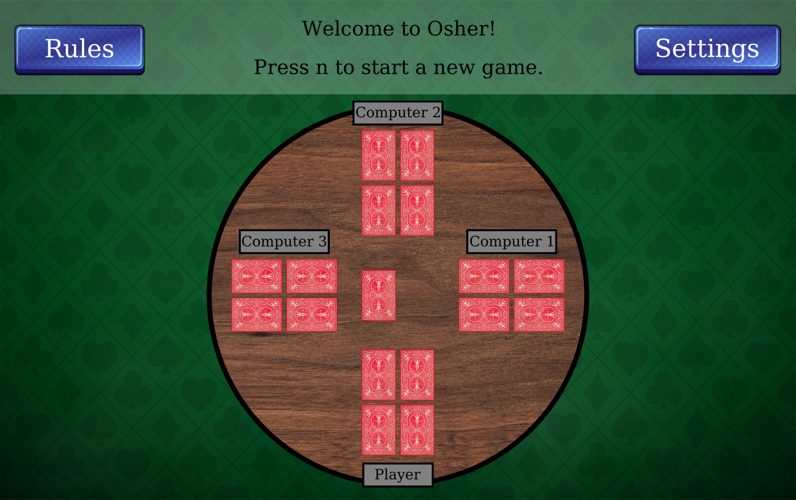

# Osher

A single-player implementation of the card game Osher, played against two to
four computer opponents. Written in Python with
[cmu_graphics](https://academy.cs.cmu.edu/desktop).



The goal is to finish with the lowest hand score. You can see only two of your
four cards at the start, so most of the game is remembering what you have,
working out what everyone else has, and deciding when to call.

## Running it

```bash
pip install "cmu-graphics==1.1.40" pillow
python Osher.py
```

Run it from the repository root — the game loads its artwork from `images/`
using relative paths, so starting it from another directory will fail.

Give the window a landscape shape. The table is sized from the smaller window
dimension, so a window taller than it is wide crowds the header and pushes
cards past the edges.

The interface is laid out for Windows system fonts — Georgia, Times New Roman,
Felix Titling and Malgun Gothic. On macOS or Linux the missing ones fall back
to a default with different metrics, so labels may not sit in their boxes
quite as neatly.

On Mac and Windows you can instead use the
[zip installer](https://academy.cs.cmu.edu/desktop) from CS Academy, which
bundles its own dependencies.

### Why the version is pinned

**Do not install cmu-graphics 2.0.5 or newer.**

From 2.0.5 onwards cmu_graphics added an MVC checker that hashes the whole app
state around every `redrawAll` and raises `MvcException` if anything changed.
This game keeps its scaled image caches on `app` — `app.cardImage`,
`app.cardFaces`, `app.tableImage`, the backgrounds — and the library mutates a
`CMUImage` internally when it draws one. The hash therefore changes every
frame and the game stops before drawing a single screen.

Nothing in the newer releases is used by this project: the whole delta is the
checker plus platform-install plumbing. 1.1.40 also supports a far wider range
of Python versions (3.6+, against 3.11–3.14 for the 2.x line).

If you ever do need a newer release, the fix is to move those image caches off
`app` into a module-level dict, which the checker does not inspect.

## Controls

The game prompts you with whichever keys are available at the time; you never
need to memorise the whole list.

| Key | What it does |
| --- | --- |
| `f` | Finish looking at a card, or confirm the two cards you viewed with a King |
| `o` | Call Osher (only while you are drawing) |
| `d` | Discard the card you just drew |
| `s` | Carry out a swap you have selected |
| `r` | Skip the power of the card you drew |
| `e` | End your turn |
| `n` | Start a new game |
| `x` | Close the rules or settings panel |
| `↑` `↓` | Scroll the rules |

Everything else is mouse-driven: click a card to stick it, to replace it with
the card you drew, or to select it for a swap.

## Rules

The full rules are in the game under the **Rules** button. In short:

- Aces are 1, number cards are face value, face cards are 10, and **red kings
  are −1**. Lowest total wins.
- You see two of your four cards once at the start, then play from memory.
- On your turn you draw from the deck or the discard pile, then either discard
  it or swap it for one of your cards.
- 7 and 8 let you look at one of your own cards; 9 and 10 at an opponent's;
  Jack and Queen swap two cards on the table; a King looks at two and swaps two.
- If a card on the table matches the rank of the top discard, you can **stick**
  it to get rid of it. Stick an opponent's card and you hand them one of yours.
  Stick wrongly, or after someone else already stuck this turn, and you take a
  penalty card. More than six cards and you lose.
- Calling **Osher** skips your next turn and gives everyone else one final
  turn. The caller's cards cannot be stuck or swapped.

## Settings

| Setting | Options | Notes |
| --- | --- | --- |
| Difficulty | Easy / Medium / Hard / Impossible | How long cards stay visible, and how quickly opponents act |
| Number of Players | 2 / 3 / 4 | Takes effect on the next new game — press `n` after changing it |
| Simplified Cards | On / Off | Plain card faces instead of the full artwork |
| Lag Reduce Mode | On / Off | Lowers the frame rate and disables hover highlighting on slower machines |

At two players your single opponent sits across the table and is simply called
"Computer".

## Project layout

```
Osher.py        the whole game
images/         61 image assets (52 card faces, backgrounds, table, UI)
```

## Credits

`makeRandomDeck` is adapted from CS Academy's Play 21 example.
