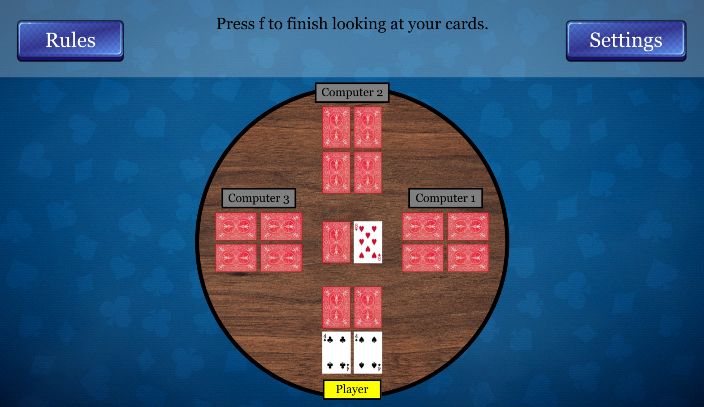

# Osher

A single-player implementation of the card game Osher, played against two to
four computer opponents. Written in Python with
[cmu_graphics](https://academy.cs.cmu.edu/desktop).



## Running it

```bash
pip install "cmu-graphics==1.1.40" pillow
python Osher.py
```

Run it from the repository root, images folder is needed

Landscape-style windows work best

Created for Windows machines, issues with font sizes on
Linux/MacOS is a known bug

On Mac and Windows you can instead use the
[zip installer](https://academy.cs.cmu.edu/desktop) from CS Academy, which
bundles its own dependencies.

**Do not install cmu-graphics 2.0.5 or newer.**

Newer versions of CMU graphics include an MVC checker that is incompatible with the game.

## Controls

The game prompts you with whichever keys are available at the time; you never
need to memorise the whole list.

| Key | What it does |
| --- | --- |
| `f` | Finish looking at a card(s) |
| `o` | Call Osher (only while you are drawing) |
| `d` | Discard the card you just drew |
| `s` | Carry out a swap you have selected |
| `r` | Skip the power of the card you drew |
| `e` | End your turn |
| `n` | Start a new game |
| `x` | Close the rules or settings panel |
| `↑` `↓` | Scroll the rules |

## Rules

You can see the rules in-game by clicking "Rules".

## Project layout

```
Osher.py        the whole game
images/         61 image assets (52 card faces, backgrounds, table, UI)
```

## Credits

`makeRandomDeck` is adapted from CS Academy's Play 21 example.
